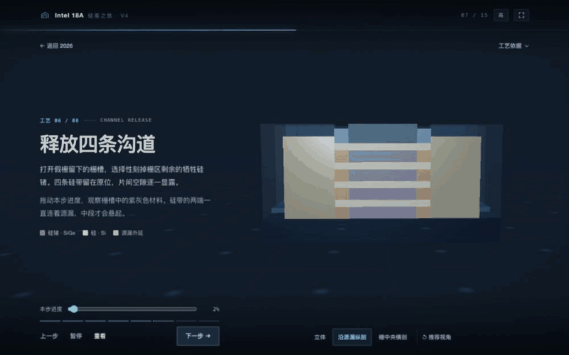

# Intel 18A · 硅基之旅（V4_Zhehao）

MECH6045 课程小组项目。Zhehao 基于 [ALL_New_V3_ZheShang](../ALL_New_V3_ZheShang/)（`6a877b9`）和小组的[《Intel 18A · 芯片的另一面》](../README.md)制作了 V4。V3 的 15 章和滚动顺序是这版的骨架。V4 让观众可以亲手开关四条沟道，进入八步制造动画，再跟着电源和信号找到成品器件上的接点。

**在电脑上打开**　从 GitHub 仓库首页选择 **Code → Download ZIP**，解压后双击 `V4_Zhehao/index.html`。请保留整个文件夹，首页会读取旁边的脚本、样式和图片。离线演示无需安装 Node.js。GitHub 中的 HTML 文件页用于阅读源码，实际操作在本地网页中进行。

## 和 V3 对照体验

| 位置 | V3 已有的内容 | V4 改了什么，去哪里看 |
|---|---|---|
| 第 7 章 · 2026 | RibbonFET 四条硅带随叙事亮起 | 点顶部「环绕栅」，先「关上开关」再「打开开关」。同一个栅极控制四条沟道，沿硅带运动的亮点同时消失、恢复。亮点用于说明导通状态。 |
| 2026 与 M6 之间 | 从成品晶体管直接进入正面互连 | 点「这四条硅带是怎么做出来的？ →」进入八步工艺。可以逐层看沟道怎样释放、栅金属怎样包围硅带，最后沿栅极接点进入 M6。直接往下滚仍可走原主线。 |
| 全部章节交界 | 随滚动切换模型、文字和标注 | 重做双向渐变和标注布局。可在「2026 ↔ M6」反复慢滚和快速倒滚，观察四带模型、金属堆栈、年份和层级刻度怎样交接。 |
| 第 8–12 章 · 正面互连与 PowerVia | 正面金属层、背面供电和通孔特写 | 重做互连堆栈与侧接路径。点顶部「背面供电」，向前回看翻面，向后沿金色支路追到器件一端。 |
| 第 15 章之后 | 从器件拉远到封装、整机并收尾 | 点「继续看晶圆与器件实验 ↓」，可对照栅极截面、改硅带宽度、切换反相器输入，并查阅芯片子电路的公开实测。 |
| 打开演示 | 启动本地服务后浏览 | 新增离线脚本，双击首页即可演示。保留开发用本地服务，Windows 启动脚本可自动选用服务或离线模式。 |

### 八步看懂 GAA 怎样形成

从抛光硅晶圆上的一个器件区开始，看同一组四层硅逐步成为四条沟道。支线沿用主页面的深色背景、材质、文字和 3D 画布。模型采用公开的堆叠硅纳米片后栅工艺顺序，以四带 RibbonFET 为成品示意，层厚、配色和剖切透明度都为教学作了简化。

| 步骤 | 在动画里看什么 |
|---|---|
| ① 生长硅与硅锗叠层 | 镜头从晶圆靠近器件区。硅与硅锗（SiGe）交替外延，米色的四层硅将成为沟道，夹在中间的硅锗将作牺牲层。 |
| ② 刻出窄鳍 | 光刻图形限定宽度，刻去两侧叠层。填入浅沟槽隔离介质并回蚀后，鳍的上部露出。 |
| ③ 定位假栅 | 临时栅横跨窄鳍，两侧形成外侧墙。切到「沿源漏纵剖」，可以看到将来金属栅所在的位置。 |
| ④ 制作内侧间隔层 | 在假栅两侧刻出源漏区，只从硅锗端部向内回蚀一小段，填入绝缘材料。此时栅区中央仍保留硅锗。 |
| ⑤ 生长源极和漏极 | 两端外延生长掺杂半导体，把四层硅接到同一对源漏。填入层间介质并抛光，露出假栅顶部。 |
| ⑥ 释放四条沟道 | 去除假栅，选择性刻掉栅区内剩余的硅锗。拖动进度条可以看见硅带之间出现空隙，两端始终与源漏相连。 |
| ⑦ 形成环绕栅 | 在硅带表面形成界面层和高介电常数栅介质，沉积功函数金属并填充栅金属。切到「栅中央横剖」，看清每条硅带外都有介质，外围金属连成一个共用栅。 |
| ⑧ 接出器件端子 | 接触形成后，点模型上的接点或「源极 S」「栅极 G」「漏极 D」，查看每个端子连到哪里。点「继续看 M6 →」，镜头沿栅极接点进入正面互连。 |



每步可以点「暂停」「继续」「重看」，用「上一步」「下一步 →」或键盘左右方向键切换。第 ⑥、⑦ 步还可手动拖动「本步进度」。点「立体」看整体，点「沿源漏纵剖」看两端怎样相连，点「栅中央横剖」看栅怎样包住每层沟道。可拖动模型，再点「推荐视角」复位。任一步点「← 返回 2026」或按 Esc，会回到进入支线时的主线位置，保留原先的开关状态和观察方向。

### 从 2026 过渡到 M6

此前最容易看出重影的位置是「2026 → M6」，四层硅带、下一章的金属线和两组标签会挤在同一画面。V4 分别控制模型和章节说明的透明度。更换模型时，旧模型先淡出到背景，再让新模型淡入。如果前后章节继续讲同一堆栈，模型可以留在画面中，只过渡章节文字、刻度和标注。模型与说明在快速回滚时也会重新同步。竖屏使用单独的相机构图，标注卡根据相邻卡片、投影点和文字区域选择位置。系统启用「减少动态效果」时，章节直接显示目标状态。

### 从正面信号追到背面电源

第 8 章先展示传统正面互连，信号线和电源线都占用晶体管上方的金属层。进入第 9–11 章后，观察正面贴合支撑片、晶圆翻转和背面减薄。预埋通孔的端部露出后，背面金属网便可接上。顺着**金色 VDD** 走，可以看到电源经垂直的纳米通孔和侧面本地接点接入器件。**蓝色 VSS** 标出回流网，**青色**标出从正面接入栅极的信号线。第 12 章拉远后，可重新辨认这条局部支路在整片电网的位置。

### 片尾的三个器件与电路实验

1. **从截面看栅极。** 选择「并排对比」，观察 FinFET 的栅包住鳍的顶部和两侧，RibbonFET 的栅环绕每条硅带。再切换「较窄硅带」「较宽硅带」，比较固定四层时的截面变化。第 7 章的「对比栅极截面」也能直达。
2. **用两个开关反相。** 点「输入 0」，看上方 pMOS 导通、nMOS 截止，输出为 1。点「输入 1」，导通路径切换到下方 nMOS，输出变为 0。
3. **读懂性能实测。** 第 14 章的「查看性能实测」可直达下表。数据来自 Intel 18A 和 Intel 3 实现同一标准 Arm 核心子电路的测试。第一列电压是 **Intel 3 参照工作点**。后两列对应两种比较条件，结果适用于所测子电路。[VLSI 2025，T1-1 图 (a)](https://dev.vlsisymposium.org/wp-content/uploads/09_EN_Technical-Tip-Sheet-VLSI-2025_EN_250522.pdf#page=1)

| Intel 3 参照工作点 | 固定功耗时，Intel 18A 的频率变化 | 固定频率时，Intel 18A 的功耗变化 |
|---|---:|---:|
| 0.75 V | 约 +18% | 约 −38% |
| 1.10 V | 约 +25% | 约 −36% |

## 15 章主线与操作

| 章节 | 主线内容 |
|---|---|
| 01–03 | 序章 → 1960 平面晶体管 → 栅长缩短带来的短沟道效应 |
| 04–06 | 2011 FinFET → 2014 多鳍结构 → 2022 年 3 nm 与合并外延 |
| 07 | 2026 RibbonFET，共用栅开关与可选的八步 GAA 制造支线 |
| 08–12 | M6 正面互连 → 正背面分工 → PowerVia 背面电网 → 通孔与侧接点 → 拉回全景 |
| 13–15 | 从器件拉远到封装和整机 → 产品实例 → 收尾及晶圆与器件实验入口 |

第 13 章也能用来检查转场。慢慢向下滚动，依次辨认芯粒、封装和整机，再倒滚观察尺度如何收回。第 14 章用 Panther Lake 的计算芯粒说明 18A 在产品中的位置，并提供「查看性能实测」入口，可从产品实例跳到子电路的测量结果。

主线支持滚轮、触控板和拖动旋转。按 ↓、PageDown 或空格到下一章，按 ↑、PageUp 到上一章，Home 和 End 到主线两端。右上角可切换画质或全屏。已打开的首页地址末尾加 `?t=0.52`、`?t=0.725`、`?t=0.78`，可分别定位到四带开关、背面电网和侧接特写。

## 给下一位维护的组员

**开发预览。** 使用 Node.js 18 或更新版本，进入 `V4_Zhehao` 后运行下列命令，再打开[本机预览](http://127.0.0.1:8124/)。通过 HTTP 浏览时，首页直接加载 `src/main.js`，修改源文件后刷新即可。Windows 也可双击 `start.cmd`。

```sh
node tools/serve.mjs . 8124
```

**更新离线演示。** 改过 JavaScript 后，请在同一目录运行下列命令，连同新生成的 `assets/v4-offline.js` 一起提交，再双击首页复查。首次获取指定版本的 esbuild 需要联网。样式表和图片由首页直接读取。

```sh
npx --yes esbuild@0.25.12 src/main.js --bundle --minify --format=iife --charset=utf8 --legal-comments=eof --alias:three/addons=./vendor/three/addons --alias:three=./vendor/three/three.module.js --outfile=assets/v4-offline.js
```

| 要改的内容 | 源文件 |
|---|---|
| 15 章的文案、权重、模型与相机动画 | [章节表](src/content.js) · [主场景](src/chapters/stage.js) · [入口及交互](src/main.js) |
| 双向章节渐变、年份与金属层刻度、3D 标注 | [渐变](src/core/transition.js) · [时间轴和标签](src/ui/ui.js) · [标注位置](src/ui/pin-placement.js) |
| 八步制造工艺的材料、剖面与镜头 | [工艺模型](src/models/fabrication.js) · [步骤播放与退出](src/chapters/fabrication.js) · [相机与视角](src/chapters/fabrication-camera.js) |
| 工艺面板、八步说明、播放按钮及布局 | [面板与文字](src/ui/fabrication-panel.js) · [面板样式](src/ui/fabrication-panel.css) |
| 正面/背面金属网和器件的局部接点 | [堆栈](src/models/stack.js) · [互连几何](src/models/interconnect-geometry.js) · [供电路径](src/models/power-path.js) |
| 晶圆全景、栅极截面、反相器及实测表 | [实验与数据](src/ui/comparisons.js) · [样式](src/ui/comparisons.css) · [晶圆配图](assets/wafer-field.webp) |

主模型由程序生成，项目内置 Three.js r170，渲染沿用 ACESFilmic 色调映射和 UnrealBloom。开发服务与截图工具均以 8124 为默认端口。[本地服务](tools/serve.mjs) · [截图工具](tools/shoot.mjs)

## 工艺与数据依据

- 八步制程的顺序与材料处理取自公开的堆叠纳米片工艺资料。第 ④ 步只回蚀端部以放置内侧间隔层，第 ⑥ 步才去除栅区剩余硅锗，这两步可以在网页中来回对照。[IEDM 2024 短课，第 12 页](https://iedm24.mapyourshow.com/mys_shared/iedm24/handouts/_SC1-2_Chao.pdf#page=12) · [imec 纳米片工艺说明](https://www.imec-int.com/en/articles/entering-nanosheet-transistor-era-0)
- 成品结构和正背面分工参照 Intel 对 RibbonFET、PowerVia 的公开示意。工艺面板右上角「工艺依据」可打开相应资料。[Intel 18A 技术简报，图 1、2](https://www.intel.com/content/dam/www/central-libraries/us/en/documents/2026-06/foundry-18a-technology-brief.pdf#page=2)
- 历史节点、器件及平台数据可追溯至 V3 留下的研究记录，其中列出了来源及置信度。[研究记录](docs/research.md) · [设计说明](docs/DESIGN.md) · [V3 自查记录](docs/REVIEW.md)

本项目用于课程展示。Intel 标志与商标归 Intel 所有。仓库许可见 [LICENSE](../LICENSE)。
