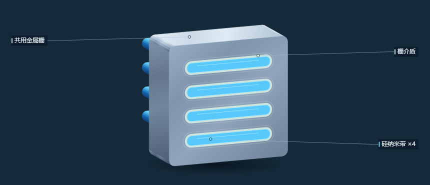
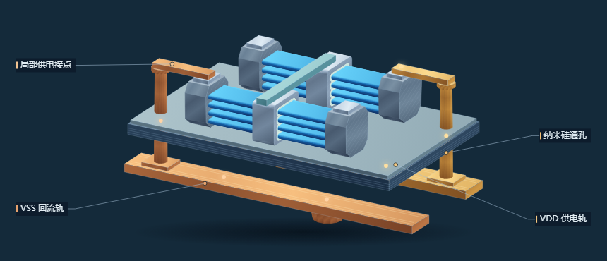

# Intel 18A 技术背景调研

## 先认出图上的三个端子

把晶体管当作一个由电压控制的开关。源极和漏极在两端，中间的硅沟道承担导电。第三个端子叫栅极，它隔着很薄的绝缘材料，用电场调节沟道导电的难易程度。顺着源、漏看，能看到电流沿什么方向走。把器件在栅极中间横切，才看得清“全环绕”的含义。[MIT 的 MOS 开关课程](https://ocw.mit.edu/courses/6-004-computation-structures-spring-2017/pages/c3/c3s1/)

读 Intel 18A 要再换一次观察尺度。放大到一只开关时，看 RibbonFET 如何控制沟道。缩小到一个逻辑单元时，看 PowerVia 如何从芯片背面把电源送到器件附近。正面信号线为栅端传送控制信号，背面金属为逻辑电路提供电源和回流路径。[Intel Foundry 工艺简报，图 1–2](https://www.intel.com/content/dam/www/central-libraries/us/en/documents/2026-06/foundry-18a-technology-brief.pdf)

## 从 FinFET 到 RibbonFET

Intel 18A 是一代制造工艺的名称。描述单个晶体管，还要分别说明栅长、纳米带宽度和厚度、相邻器件间距等几何量。这里用 **RibbonFET** 指 Intel 的环绕栅晶体管，用 **PowerVia** 指从芯片背面分配电源的互连技术。前者改变开关内部的电场，后者改变电源到开关的路径。[Intel 关于节点命名的说明，第 3 页](https://download.intel.com/newsroom/2021/client-computing/accelerating-process-innovation.pdf) · [Intel 18A 官方简介](https://www.intel.com/content/www/us/en/newsroom/news/intel-18a-process-technology-simply-explained.html)

在实际产品中，2026 年第一季度上市的 Core Ultra X9 388H（Panther Lake）便采用了这项技术。Intel 给该处理器标注的 CPU 制程是 Intel 18A，GPU 制程是 TSMC N3E。同一封装中可以并存不同工艺的芯粒，这个实例让动画中的晶体管有了具体位置。[Intel 产品规格，见 CPU Lithography 与 GPU Lithography](https://www.intel.com/content/www/us/en/products/sku/245526/intel-core-ultra-x9-processor-388h-18m-cache-up-to-5-10-ghz/specifications.html)

### 从两个方向看同一只晶体管

从侧面看，源极和漏极位于两端，数条薄硅带水平跨接在两端之间，沿高度方向叠放。栅极位于这段路径中间。从源极朝漏极的方向看，把截面取在栅中央，每条带的上、下和两侧都有栅介质与栅金属。栅金属填入带与带之间的间隙，连成一个电极。Intel 技术简报图 1 给出了这一截面。SemiAnalysis 实验室对 Panther Lake 计算芯粒取样，也观察到四条带，并在不同逻辑区测到不同带宽。[Intel Foundry 技术简报，图 1](https://www.intel.com/content/dam/www/central-libraries/us/en/documents/2026-06/foundry-18a-technology-brief.pdf) · [Panther Lake 实物剖面，RibbonFET 一节](https://newsletter.semianalysis.com/p/intel-panther-lake-teardown)

由这个连接关系可知，**上下堆叠的是沟道，电气上并联的是源极与漏极之间的几条导电路径**。每条路径都受同一个栅压控制。画动画时，从正面信号线追到栅端，再把各层沟道同时点亮，可以解释一个输入怎样控制多条路径。四层分别接四根控制线会改变这只器件的电路含义。[Intel Foundry 技术简报，图 1](https://www.intel.com/content/dam/www/central-libraries/us/en/documents/2026-06/foundry-18a-technology-brief.pdf) · [imec 对堆叠纳米片结构的解释](https://www.imec-int.com/en/articles/entering-nanosheet-transistor-era-0)

### 栅极为什么要绕一圈

平面 MOSFET 从沟道上方施加控制。FinFET 把硅做成竖起的薄鳍，栅极覆盖鳍顶及两侧。器件做短后，漏端电场也会影响源端附近的势垒，使关断状态下的电流更难压低。RibbonFET 把每条硅带的底面也纳入栅极控制，从更多方向约束沟道电势。对设计者而言，收益之一是可以在驱动能力、工作电压和关断漏电之间重新取舍。[imec 的器件演进说明](https://www.imec-int.com/en/articles/entering-nanosheet-transistor-era-0) · [Intel Foundry 对 RibbonFET 电学控制的说明](https://www.intel.com/content/www/us/en/foundry/process/18a.html)

以 n 型晶体管为例，设漏极电压高于源极。抬高栅极相对源极的电压，可以降低电子从源端进入沟道的势垒。导通时电子可沿各层从源向漏移动，电路图上的约定电流方向则从漏向源。栅介质将栅金属与硅隔开，开关靠电场调节。阈值附近的电流连续变化，关断时仍有漏电。动画里的亮灭只表示导通强弱，光点密度不代表实测电流。[MIT 6.012 势垒与栅压](https://ocw.mit.edu/courses/6-012-microelectronic-devices-and-circuits-fall-2009/42c863e2e1e9744ce6b797646a30e463_MIT6_012F09_lec09.pdf) · [MIT 6.004 对 MOS 开关的解释](https://ocw.mit.edu/courses/6-004-computation-structures-spring-2017/pages/c3/c3s1/)

### 多层和带宽分别解决什么问题

把纳米带叠高，在同一片平面占地上就能容纳更多受栅控制的沟道表面。把截面近似为宽 W、厚 T 的矩形，N 条相同带的几何总周长约为 2N(W+T)。这个几何近似便于解释有效沟道宽度的来源。圆角、各晶面的载流子迁移率、接触电阻和栅电容都会影响实测电流与速度。增加带宽通常能增强驱动，同时增加负载电容。不同逻辑路径可以选不同宽度和阈值的器件。Intel 公开资料列有 160 nm 与 180 nm 两种标准单元高度，分别提供相应的器件选项，这个高度量的是单元版图。[IBM 首次展示堆叠纳米片的器件论文](https://research.ibm.com/publications/stacked-nanosheet-gate-all-around-transistor-to-enable-scaling-beyond-finfet) · [imec 对驱动能力和电容的分析](https://www.imec-int.com/en/articles/entering-nanosheet-transistor-era-0) · [Intel 18A 家族简报，表 1](https://www.intel.com/content/dam/www/central-libraries/us/en/documents/2026-06/foundry-18a-technology-brief.pdf)

### 这些悬空的带如何制造

研究机构公开的典型流程会先生长交替的硅和硅锗层，在预定栅区选择性去掉硅锗，留下两端受支撑的硅纳米带，再在各层硅表面形成栅介质，并在狭小间隙中沉积栅材料。内侧间隔层隔开栅和源漏，有助于减小寄生电容。选择性蚀刻既要打开带间空隙，又要尽可能保持薄硅带的形状和表面质量。此处描述通用 GAA 工艺原理。Intel 对 18A 的公开采访确认了分层形成、刻蚀及局部材料沉积，具体配方和公差须以相应工艺设计资料为准。[imec 的纳米片集成研究](https://www.imec-int.com/en/articles/entering-nanosheet-transistor-era-0) · [IBM 关于沟道释放与源漏保护的实验](https://research.ibm.com/publications/epi-source-drain-damage-mitigation-during-channel-release-of-stacked-nanosheet-gate-all-around-transistors) · [Intel 器件工程负责人访谈](https://www.intel.com/content/www/us/en/newsroom/news/corporate/device-engineering-ambitions-real-silicon-collide.html)

## 电怎样从芯片背面到达晶体管

面向正面信号线的是器件的“正面”，芯片封装翻转后，这个名称依然沿用。把剖面画成三层，从上到下依次是正面信号互连、晶体管、背面供电互连。在传统正面供电设计里，电源线和信号线都占用正面多层金属，电源要经过一连串层间连接才能到达器件附近。Intel 18A 把主要供电网络放到另一面，正面留出更多空间给逻辑信号。[Intel 18A 工艺技术简报，图 2](https://www.intel.com/content/dam/www/central-libraries/us/en/documents/2026-06/foundry-18a-technology-brief.pdf)

### 跟着一条供电轨走

从芯片背面的供电凸点出发，较粗的金属线先分配电流，靠近器件的局部金属再把电源送到标准单元。标准单元就是设计芯片时反复排列的小电路，例如一个反相器。单元内的纳米级硅通孔（nano-TSV）沿垂直方向接到局部源／漏接触，再由接触连到对应晶体管端子。Panther Lake 计算芯粒的截面观测显示，通孔位于器件旁边，背面电源线与正面接触在这里接通。[Intel 18A 工艺页](https://www.intel.com/content/www/us/en/foundry/process/18a.html) · [SemiAnalysis STEEL 实验室的原始截面观测](https://newsletter.semianalysis.com/p/intel-panther-lake-teardown)

### 一个反相器怎样使用两套连线

以 CMOS 反相器为例，VDD 高电位电源轨接上拉 pMOS 的源极，VSS 地线接下拉 nMOS 的源极。两者的栅极同接输入信号，漏极相连形成输出。输入变高，nMOS 导通，把输出拉低。输入变低，pMOS 导通，把输出拉高。图中可以用两种颜色分别追踪输入信号与一条电源轨。画出 VDD 和 VSS 时，要让两条轨道各有自己的通孔和接点。动画中移动的光点表示线路走向。实际电荷和电压的变化取决于器件状态及负载。[Panther Lake 拆解中的反相器及 PowerVia 剖面](https://newsletter.semianalysis.com/p/intel-panther-lake-teardown)

### 压降与动态跌落

稳态下，一段连线的电阻为 R，流过电流 I 时，其两端产生约 I × R 的压降。较短、较宽的背面供电路径有助降低等效电阻。很多晶体管同时切换时，电流需求突然增加，供电网络的阻抗会让局部电源电压短暂下跌。除了电阻，这种动态跌落还取决于电感、去耦电容以及负载变化的速度。更稳的局部电压有助于逻辑门在设定时钟周期内完成翻转。正面腾出的走线空间则有助于把标准单元排得更紧。[Intel 18A 工艺技术简报，PowerVia 与 Spotlight 2](https://www.intel.com/content/dam/www/central-libraries/us/en/documents/2026-06/foundry-18a-technology-brief.pdf)

### 翻面、减薄与散热

以该 Panther Lake 截面的工艺重建为例，先从器件侧形成局部接触及通孔，再完成正面金属布线。支撑晶圆贴合到正面后，晶圆翻转，原有衬底从背面减薄到通孔端部露出，然后形成背面多层金属。支撑、减薄及两面的连接对准给制造增加了要求。成品还要让热穿过多种材料并传出去，高功率密度区域的散热需要单独验证。[SemiAnalysis 工艺重建](https://newsletter.semianalysis.com/p/intel-panther-lake-teardown) · [Intel 的背面供电测试与热验证](https://www.intc.com/news-events/press-releases/detail/1623/powervia-test-shows-industry-leading-performance)

## 性能数字和实验条件

2025 年 VLSI 会议上，Intel 用标准 Arm 核子模块比较 18A 与 Intel 3。作者报告，在以 0.75 V 和 1.1 V 为参照的两个工作点，等功耗性能分别提升 18% 和 25%。Intel 后续技术简报汇总了等性能时功耗降低 38% 的另一使用方式。等功耗与等性能沿着两条不同的方向读取功耗—频率曲线。比较对象包含晶体管、互连、背面供电和设计优化的共同变化。由这些数据无法拆出某一层纳米带的贡献，也无法直接推算一台电脑的应用速度或续航。[VLSI 2025 作者摘要 T1-1](https://archive.vlsisymposium.org/25web/wp-content/uploads/VLSI2025_Advanceprogram0611.pdf) · [会议官方功耗—频率图](https://archive.vlsisymposium.org/25web/wp-content/uploads/09_EN_Technical-Tip-Sheet-VLSI-2025_EN_250522.pdf) · [Intel Foundry 技术简报，图 4](https://www.intel.com/content/dam/www/central-libraries/us/en/documents/2026-06/foundry-18a-technology-brief.pdf)

| 研究对象 | 公开结果 | 该数字描述什么 |
| --- | --- | --- |
| 2023 年，Intel 4 FinFET 的 Blue Sky Creek E-core 测试芯片 | 与相似的正面供电设计比较，平台电压跌落改善超过 30%，频率提升约 6%。该实现的标准单元利用率超过 90%。 | 在引入 RibbonFET 前单独验证 PowerVia。90% 衡量布局利用率，30% 衡量电压跌落，二者均不能当作节电比例。[Intel VLSI 2023 论文摘要](https://ieeexplore.ieee.org/abstract/document/10185208/figures) · [Intel 测试说明](https://www.intc.com/news-events/press-releases/detail/1623/powervia-test-shows-industry-leading-performance) |
| 2026 年公布的 CPU 核供电比较 | 技术简报图 9 对照采用正面供电的 Intel 3 与采用背面供电的 Intel 18A 实现。其最坏动态电压跌落约降至原来的十分之一。 | 比较的是指定 CPU 核供电分析中的瞬时电压跌落。此数字不能换算成整颗处理器的功耗或运行速度。[Intel 工艺技术简报，图 9](https://www.intel.com/content/dam/www/central-libraries/us/en/documents/2026-06/foundry-18a-technology-brief.pdf) |
| 2026 年公布的已完成布线的逻辑块 | 依供电网络假设而异，Intel 报告逻辑块面积缩小约 6% 至 11%。 | 此处衡量完成布线后的电路块占地。选择单元库、电源线布局与时序约束都会影响结果。[Intel 技术简报](https://www.intel.com/content/dam/www/central-libraries/us/en/documents/2026-06/foundry-18a-technology-brief.pdf) · [Intel VLSI 2026 报告](https://www.intel.com/content/www/us/en/newsroom/news/corporate/intel-foundry-details-process-milestones-future-innovation-at-vlsi-symposium.html) |

## 示意图与实物之间

基础版 18A 的演示应表现侧边 nano-TSV 接到局部接触的路径。Intel 将 18A-P 部分器件的新双接触选项称为 Power Boost，将 14A 的直接接触供电称为 PowerDirect。后两种结构各有自己的适用平台。[Intel 18A 系列技术简报，图 8](https://www.intel.com/content/dam/www/central-libraries/us/en/documents/2026-06/foundry-18a-technology-brief.pdf) · [Intel 对 14A PowerDirect 的说明](https://www.intc.com/news-events/press-releases/detail/1739/intel-foundry-gathers-customers-and-partners-outlines)

### 从公开证据到动画

栅剖面的四条硅带取自 Intel 技术简报图 1，并与 Panther Lake 的实物截面对照。硅、栅介质和金属在动画里用不同颜色编码。实际材料的颜色、层厚及圆角未按显微图复现。为便于观察，模型截去了部分接触和互连，分层滑杆也会刻意拉大层间距离。两条电源轨只代表标准单元中选取的供电支路。

沟道亮灭表示 n 型器件导电强弱的改变。背面光点用来追踪连线。图中的速度、亮度和运动距离均为教学参数。要预测工作电流、温升或最高频率，还需要相应工艺的器件模型、版图寄生参数、实际负载与热边界条件。[Intel 18A 结构与平台数据](https://www.intel.com/content/www/us/en/foundry/process/18a.html)

## 资料与图号

- [Intel Foundry · Intel 18A Process Node Family](https://www.intel.com/content/dam/www/central-libraries/us/en/documents/2026-06/foundry-18a-technology-brief.pdf)。图 1 用于核对栅与硅带的相对位置，图 2 对照正面与背面互连，图 4 和图 9 给出平台和供电数据。
- [Fischer 等 · VLSI 2025 会议技术要点，T1-1](https://archive.vlsisymposium.org/25web/wp-content/uploads/09_EN_Technical-Tip-Sheet-VLSI-2025_EN_250522.pdf)。有工作点、比较基准和作者图表。[会议议程与作者摘要](https://archive.vlsisymposium.org/25web/wp-content/uploads/VLSI2025_Advanceprogram0611.pdf)可交叉核对。
- [Intel · PowerVia 测试芯片说明](https://www.intc.com/news-events/press-releases/detail/1623/powervia-test-shows-industry-leading-performance)。涉及 2023 年 E-core 测试片及热验证。
- [SemiAnalysis STEEL · Panther Lake Teardown](https://newsletter.semianalysis.com/p/intel-panther-lake-teardown)。实验室取得的器件截面提供独立实物对照。部分内容可能需要订阅。
- [imec · Entering the nanosheet transistor era](https://www.imec-int.com/en/articles/entering-nanosheet-transistor-era-0)。解释纳米片释放工艺、带宽选择和电容取舍。
